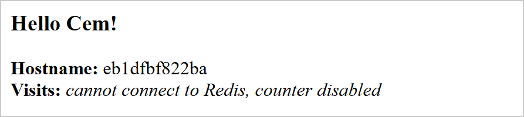
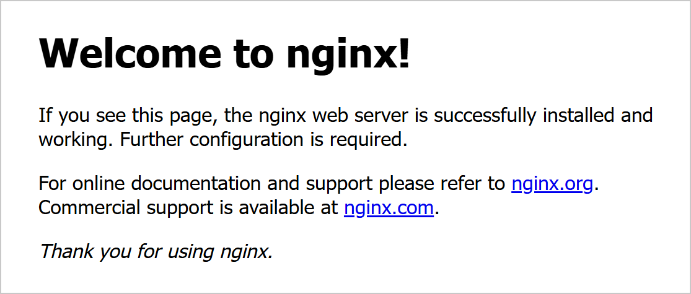

# Lab 11 – Containerization

**Student:** Cem Dudu  
**Student number:** 101496484  
**Course:** COMP3104 DevOps, George Brown College

This repo has my work for Lab 11. In Part I, I built my own Docker image for a small Flask app and ran it as a container. In Part II, I deployed nginx to a local Kubernetes cluster with Minikube.

**Links**

- My fork of the exercise repo: https://github.com/Cem-Gbc/DevOps_Kubernetes_exercise9
- My image on Docker Hub: https://hub.docker.com/r/cem46/hellodocker (tag `lab11`)

## What is in this repo

| Folder / file | What it is |
| --- | --- |
| `lab11_Docker/` | Dockerfile, app.py and requirements.txt for Part I |
| `k8s/` | nginx-deploy.yaml and nginx-service.yaml for Part II (copied from my fork) |
| `screenshots/` | A screenshot of every command I ran, numbered in order |

I ran everything in Windows PowerShell on my Windows 11 laptop with Docker Desktop.

## Part I: My own Docker image

I made a folder called `lab11_Docker` with three files: `requirements.txt`, `Dockerfile` and `app.py`. The files are the same as in the lab. The only change is `ENV NAME Cem` in the Dockerfile, so the page says hello to me.

The app is a small Flask web server. It tries to count visits in Redis. I did not run a Redis container in this lab, so the page says "cannot connect to Redis, counter disabled". This is the expected result.

Commands I ran, in order:

1. `docker --version`  
   Check that Docker is installed. [Screenshot 01](screenshots/01_docker-version.png)
2. `docker run hello-world`  
   Check that Docker can pull an image and run a container. [Screenshot 02](screenshots/02_docker-run-hello-world.png)
3. `dir`  
   Show the three files in the lab11_Docker folder. [Screenshot 03](screenshots/03_lab-folder-dir.png)
4. `type Dockerfile`, `type requirements.txt`, `type app.py`  
   Show the contents of the files. [Screenshot 04](screenshots/04_type-dockerfile.png), [05](screenshots/05_type-requirements.png), [06](screenshots/06_type-app-py.png)
5. `docker build --tag=hellodocker .`  
   Build the image from the Dockerfile. [Screenshot 07](screenshots/07_docker-build.png)
6. `docker image ls` and `docker image ls hellodocker`  
   Check that the new image is there. [Screenshot 08](screenshots/08_docker-image-ls.png), [09](screenshots/09_docker-image-ls-hellodocker.png)
7. `docker run -p 4000:80 hellodocker`  
   Run the container. Port 4000 on my laptop goes to port 80 in the container. I kept this window open. [Screenshot 10](screenshots/10_docker-run-hellodocker.png)
8. `curl.exe http://localhost:4000` (in a second window) and the same page in Microsoft Edge  
   [Screenshot 11](screenshots/11_curl-localhost-4000.png), [12](screenshots/12_browser-localhost-4000.png). The requests show up in the docker run window: [Screenshot 13](screenshots/13_docker-run-request-log.png)
9. `docker container ls`, `docker container stop eb1dfbf822ba`, `docker container ls`  
   Find the running container, stop it, and check that it is gone. [Screenshot 14](screenshots/14_docker-container-ls.png), [15](screenshots/15_docker-container-stop.png), [16](screenshots/16_docker-container-ls-after-stop.png)
10. `docker tag hellodocker cem46/hellodocker:lab11`  
    Tag the image with my Docker Hub user name. [Screenshot 17](screenshots/17_docker-tag.png)
11. `docker push cem46/hellodocker:lab11`  
    Push the image to Docker Hub. [Screenshot 18](screenshots/18_docker-push.png)
12. `docker image ls cem46/hellodocker`  
    Show the tagged image. [Screenshot 19](screenshots/19_docker-image-ls-tagged.png)

This is the app in the browser:

## Part II: nginx on Kubernetes with Minikube

I used Minikube with the Docker driver. I forked the exercise repo and used the two YAML files from its `k8` folder. The Deployment is called `nginx` and runs 3 nginx pods. The Service is called `nginx-nodeport` and uses node port 30080.

Commands I ran, in order:

1. `minikube version` and `kubectl version --client`  
   Check the tools. [Screenshot 20](screenshots/20_minikube-version.png), [21](screenshots/21_kubectl-version.png)
2. `minikube start --driver=docker`  
   Start the local cluster. [Screenshot 22](screenshots/22_minikube-start.png)
3. `kubectl get nodes`  
   Check that the node is Ready. [Screenshot 23](screenshots/23_kubectl-get-nodes.png)
4. `gh repo fork pritamworld/DevOps_Kubernetes_exercise9 --clone`  
   Fork and clone the exercise repo. [Screenshot 24](screenshots/24_gh-repo-fork-clone.png)
5. `dir` and `dir -Recurse -Filter "nginx-*.yaml"`  
   Find the YAML files. They are in the `k8` folder. [Screenshot 25](screenshots/25_fork-repo-dir.png), [26](screenshots/26_find-yaml-files.png)
6. `type nginx-deploy.yaml` and `type nginx-service.yaml`  
   Show the two files. [Screenshot 27](screenshots/27_type-nginx-deploy.png), [28](screenshots/28_type-nginx-service.png)
7. `kubectl apply -f nginx-deploy.yaml`  
   Create the Deployment. [Screenshot 29](screenshots/29_kubectl-apply-deploy.png)
8. `kubectl apply -f nginx-service.yaml`  
   Create the Service. [Screenshot 30](screenshots/30_kubectl-apply-service.png)
9. `kubectl rollout status deployment/nginx`  
   Wait until the Deployment is ready. [Screenshot 31](screenshots/31_kubectl-rollout-status.png)
10. `kubectl get pods -l app=nginx -o wide`  
    Show the 3 running pods. [Screenshot 32](screenshots/32_kubectl-get-pods.png)
11. `kubectl get svc nginx-nodeport`  
    Show the Service and the port 80:30080. [Screenshot 33](screenshots/33_kubectl-get-svc.png)
12. `minikube service nginx-nodeport --url`  
    Open a tunnel to the Service. This command keeps running, so I kept the window open. It printed `http://127.0.0.1:62313`. [Screenshot 34](screenshots/34_minikube-service-url.png)
13. `curl.exe http://127.0.0.1:62313` (in a second window) and the same page in Microsoft Edge  
    I got the nginx welcome page. [Screenshot 35](screenshots/35_curl-tunnel-url.png), [36](screenshots/36_browser-nginx.png)
14. `minikube ip`  
    The Minikube IP is 192.168.49.2. [Screenshot 37](screenshots/37_minikube-ip.png)
15. `curl.exe --max-time 5 http://192.168.49.2:30080`  
    This timed out. [Screenshot 38](screenshots/38_curl-minikube-ip-30080.png)
16. `kubectl delete -f nginx-deploy.yaml` and `kubectl delete -f nginx-service.yaml`  
    Delete the Deployment and the Service. [Screenshot 39](screenshots/39_kubectl-delete-deploy.png), [40](screenshots/40_kubectl-delete-service.png)
17. `kubectl get all`  
    Only the default `kubernetes` service is left. [Screenshot 41](screenshots/41_kubectl-get-all.png)
18. `minikube stop`  
    Stop the cluster. [Screenshot 42](screenshots/42_minikube-stop.png)

This is nginx in the browser through the Minikube tunnel:

### Why I used the tunnel URL

On Windows with the Docker driver, the Minikube node runs inside a Docker container. Its IP (192.168.49.2) is on a Docker network that my laptop cannot reach. So `http://192.168.49.2:30080` does not work from Windows and the request timed out. `minikube service nginx-nodeport --url` opens a tunnel from 127.0.0.1 to the Service. That is why I used the 127.0.0.1 URL.

## Notes

- `docker build` shows one warning: `LegacyKeyValueFormat` for the line `ENV NAME Cem`. The newer format is `ENV NAME=Cem`. I kept the line the way the lab gives it. The image builds fine.
- My Docker Desktop version does not print a `Username:` line in `docker info`. Docker Desktop showed that I was signed in as `cem46`, and the push worked.
